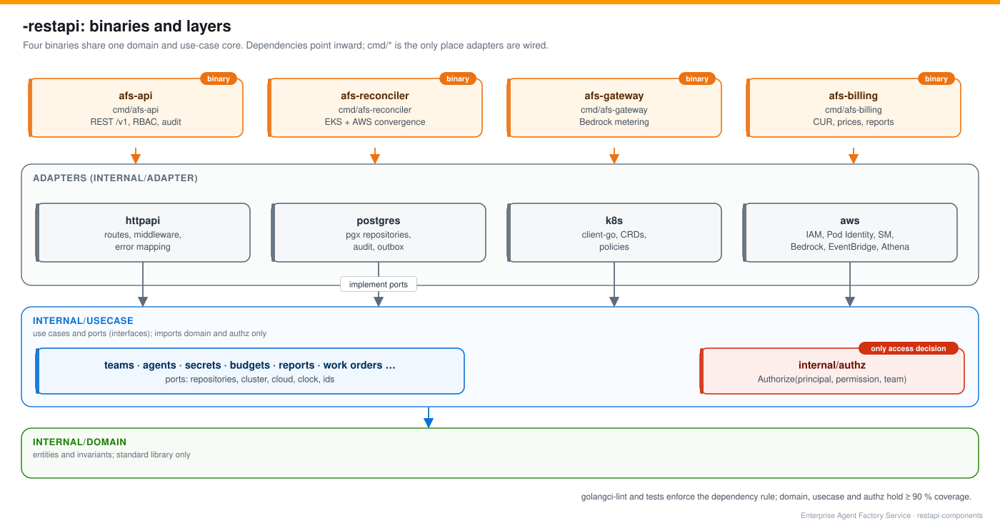
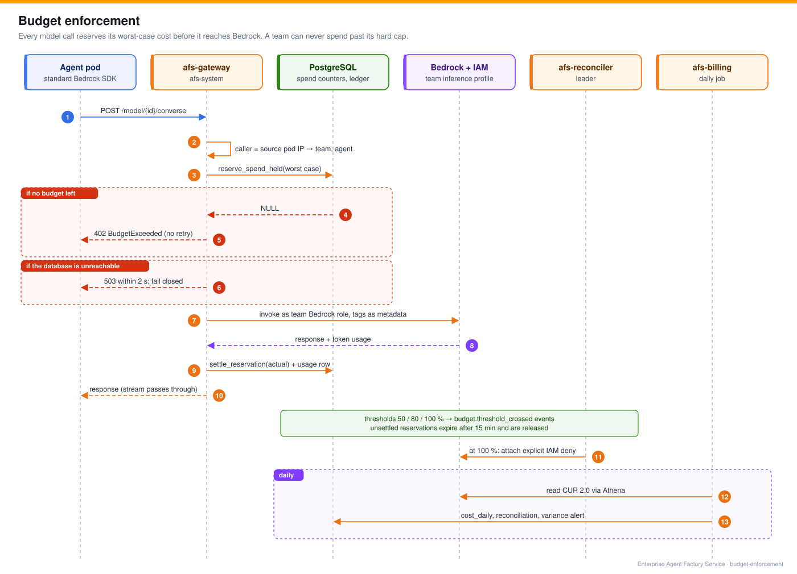
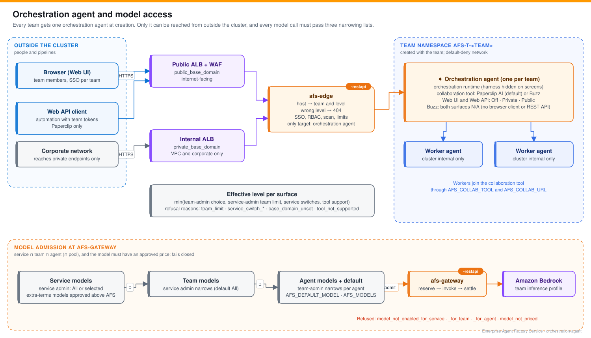

# enterprise-agent-factory-service-restapi

**The control plane of the [Enterprise Agent Factory Service](https://github.com/stainedhead/enterprise-agent-factory-service), in Go:**
the REST API that every client uses and that enforces role-based access, the reconciler that applies desired
state to EKS and AWS, the Bedrock gateway that meters every model call and enforces hard budget caps, and
the billing job that reconciles against the AWS Cost and Usage Report. It owns the API contract,
[`api/openapi.yaml`](api/openapi.yaml).

| | |
|---|---|
| **Deploy and run it** | [Getting started](user-docs/getting-started.md) · [Deployment](user-docs/deployment.md) · [Configuration](user-docs/configuration.md) · [Observability](user-docs/observability.md) · [All user docs](user-docs/README.md) |
| **Call it** | [Usage examples](user-docs/usage-examples.md) · [Authentication and limits](user-docs/authentication-and-limits.md) · [OpenAPI](api/openapi.yaml) · [API contract](https://github.com/stainedhead/enterprise-agent-factory-service/blob/main/docs/contracts/api-contract.md) |
| **Change it** | [CONTRIBUTING.md](CONTRIBUTING.md) · [AGENTS.md](AGENTS.md) · [Technical details](docs/technical-details.md) · [Decisions](docs/architectural-decision-record.md) · [PRD](enterprise-agent-factory-service-restapi-PRD.md) |

## Where it fits


## Binaries

| Binary | Purpose | Guide |
|---|---|---|
| `afs-api` | REST API: authentication, RBAC on every route, audit, idempotency, optimistic concurrency | [getting started](user-docs/getting-started.md) |
| `afs-reconciler` | Applies desired state to EKS and AWS, reverts drift, tags resources, publishes events, housekeeping | [reconciler](user-docs/reconciler.md) |
| `afs-gateway` | Bedrock-compatible and Anthropic-compatible proxy: per-team metering and hard caps, fails closed | [gateway contract](https://github.com/stainedhead/enterprise-agent-factory-service/blob/main/docs/contracts/gateway-contract.md) |
| `afs-edge` | The public entry of the Paperclip collaboration feature: sign-in, role checks, credential scan, access counts, forwarding to a team's Paperclip | [collaboration edge](user-docs/collaboration-edge.md) |
| `afs-billing` | CUR ingest and reconciliation, price proposals, scheduled reports, showback | [billing](user-docs/billing.md), [reports](user-docs/reports.md) |



## How a request is handled

Every `/v1` route declares the permission it needs; `internal/authz` is the only place access is decided. A
mutation writes its row, an audit record and (where the contract names one) an outbox event in one
transaction as `afs_app`, under row-level security.


## How desired state becomes real

`afs-api` never calls Kubernetes. The reconciler picks up each committed change from the database change
feed and converges the cluster and AWS, then writes status back for clients to read.


## How spend is capped



## What the reconciler builds for each team


## The orchestration agent and model access (1.1.0)

`afs-api` creates each team's orchestration agent in the `CreateTeam` transaction. `afs-edge` forwards its public or
private hostname at the effective exposure level, and `afs-gateway` admits a model call only when the model is in
the service, team and agent lists and has an approved price.



## Model routes and the team gateway (1.2.0)

A team set to `per_namespace` gets its own `afs-gateway` in its namespace. Its agents call OpenAI-compatible routes
(OpenAI, OpenRouter, Nous Portal, OpenCode, Azure, Google Vertex AI, corporate and in-namespace servers) at
`$(AFS_GATEWAY_URL)/r/<route>/v1`, metered and capped like Bedrock; only that gateway holds the team's route credentials
and may reach the route hosts. Every provider is a service-admin switch. `afs-billing` reconciles each route against the
provider's own figures. See [model routes](user-docs/model-routes.md).

## Build and test

Requires Go 1.27 (pinned in `go.mod`; older Go fetches it) and `make`.

```bash
make gate     # tidy, fmt-check, vet, openapi and contract checks, golangci-lint, race tests, build
make cover    # at least 90% on domain, usecase and authz
make build    # binaries in ./bin
./bin/afs-api --addr :8080
curl localhost:8080/healthz
```

Integration tests need PostgreSQL 17: set `AFS_TEST_DATABASE_URL` and run `make test-db`. Kubernetes adapter
tests run with `make envtest` (needs `KUBEBUILDER_ASSETS`). `make e2e`, `make load` and `make conformance` run
the build-tagged suites on a cluster. Deployment assets are in [deploy/terraform](deploy/terraform) and
[deploy/helm/afs](deploy/helm/afs).

## Status

Release 1.2.0 (lockstep with `-db`): all 221 operations of API contract v1.5.0 are implemented behind the permission
matrix (the v1.6.0 MCP operations merged for 1.3.0 answer `501 not_implemented` until then), with the reconciler,
gateway, billing jobs and edge. 1.2.0 adds model routes to OpenAI-compatible endpoints through a team gateway in the
team's namespace, provider switches (Bedrock included) and route billing; see
[model routes](user-docs/model-routes.md) and [upgrading to 1.2.0](user-docs/upgrading-to-1.2.0.md). Checks that need a
real cloud (EKS, live Azure and Google federation, provider billing APIs) are recorded as deferred in
`specs/261125-model-endpoint-gateway/implementation-notes.md`. `-db` is pinned to a pseudo-version of the commit that
carries migration 000023 until `-db` v1.2.0 is tagged.

## Contributing

Read [CONTRIBUTING.md](CONTRIBUTING.md) and the product-wide
[contributing guide](https://github.com/stainedhead/enterprise-agent-factory-service/blob/main/CONTRIBUTING.md).
Why this repository exists: [INTENT.md](INTENT.md).
