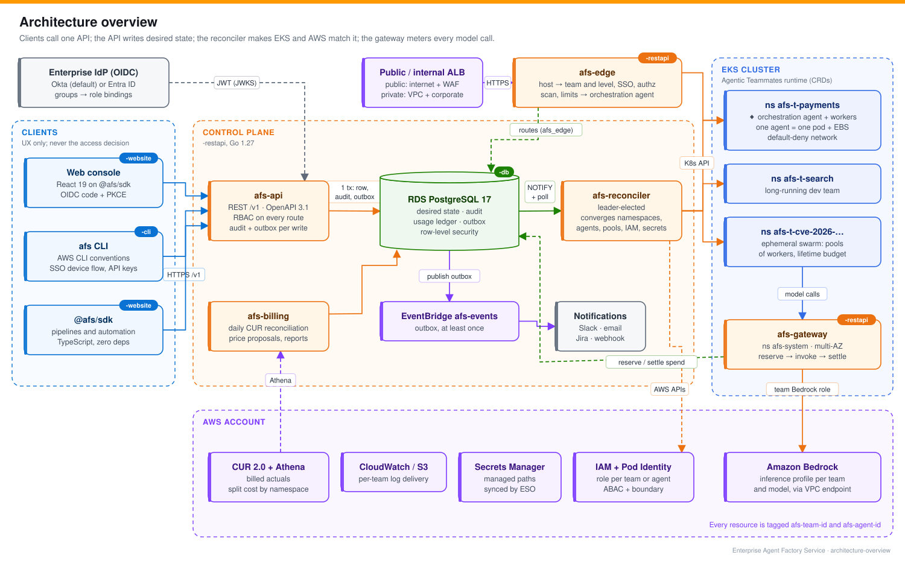
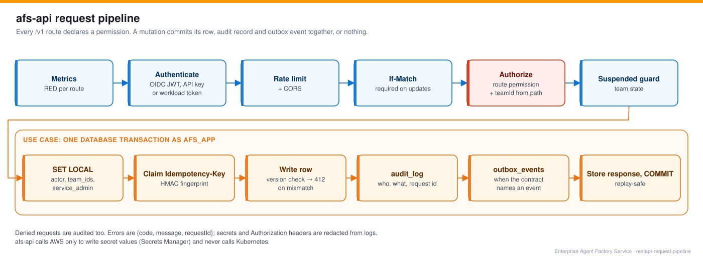
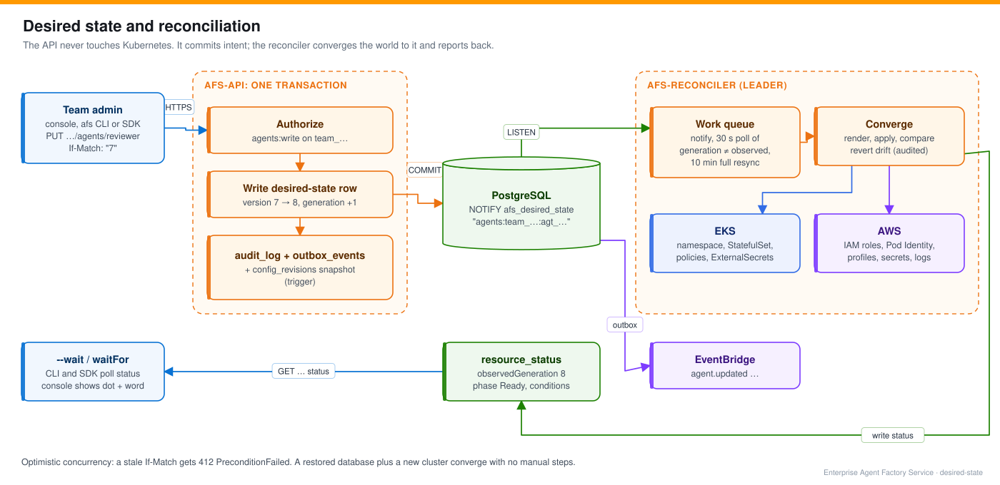
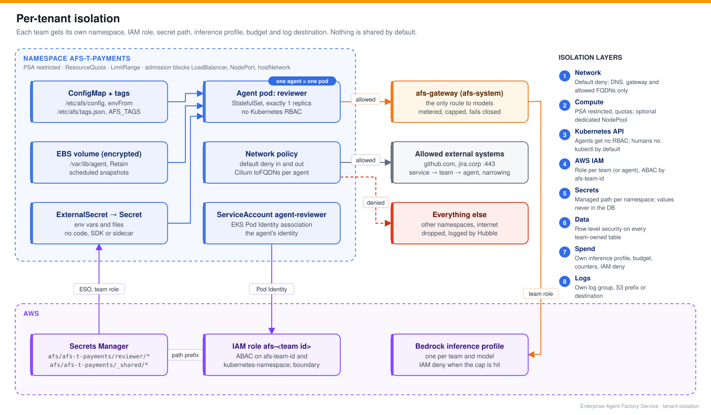

# enterprise-agent-factory-service-restapi

**The control plane of the [Enterprise Agent Factory Service](https://github.com/stainedhead/enterprise-agent-factory-service), in Go:**
the REST API that every client uses and that enforces role-based access, the reconciler that applies desired
state to EKS and AWS, the Bedrock gateway that meters every model call and enforces hard budget caps, and
the billing job that reconciles against the AWS Cost and Usage Report. It owns the API contract,
[`api/openapi.yaml`](api/openapi.yaml).

| | |
|---|---|
| **Deploy and run it** | [Getting started](user-docs/getting-started.md) · [Deployment](user-docs/deployment.md) · [Configuration](user-docs/configuration.md) · [Observability](user-docs/observability.md) · [All user docs](user-docs/README.md) |
| **Call it** | [Usage examples](user-docs/usage-examples.md) · [Authentication and limits](user-docs/authentication-and-limits.md) · [OpenAPI](api/openapi.yaml) · [API contract](https://github.com/stainedhead/enterprise-agent-factory-service/blob/main/docs/contracts/api-contract.md) |
| **Change it** | [CONTRIBUTING.md](CONTRIBUTING.md) · [AGENTS.md](AGENTS.md) · [Technical details](docs/technical-details.md) · [Decisions](docs/architectural-decision-record.md) · [PRD](enterprise-agent-factory-service-restapi-PRD.md) |

## Where it fits



## Binaries

| Binary | Purpose | Guide |
|---|---|---|
| `afs-api` | REST API: authentication, RBAC on every route, audit, idempotency, optimistic concurrency | [getting started](user-docs/getting-started.md) |
| `afs-reconciler` | Applies desired state to EKS and AWS, reverts drift, tags resources, publishes events, housekeeping | [reconciler](user-docs/reconciler.md) |
| `afs-gateway` | Bedrock-compatible and Anthropic-compatible proxy: per-team metering and hard caps, fails closed | [gateway contract](https://github.com/stainedhead/enterprise-agent-factory-service/blob/main/docs/contracts/gateway-contract.md) |
| `afs-billing` | CUR ingest and reconciliation, price proposals, scheduled reports, showback | [billing](user-docs/billing.md), [reports](user-docs/reports.md) |


## How a request is handled

Every `/v1` route declares the permission it needs; `internal/authz` is the only place access is decided. A
mutation writes its row, an audit record and (where the contract names one) an outbox event in one
transaction as `afs_app`, under row-level security.



## How desired state becomes real

`afs-api` never calls Kubernetes. The reconciler picks up each committed change from the database change
feed and converges the cluster and AWS, then writes status back for clients to read.



## How spend is capped


## What the reconciler builds for each team



## Build and test

Requires Go 1.27 (pinned in `go.mod`; older Go fetches it) and `make`.

```bash
make gate     # tidy, fmt-check, vet, openapi and contract checks, golangci-lint, race tests, build
make cover    # at least 90% on domain, usecase and authz
make build    # binaries in ./bin
./bin/afs-api --addr :8080
curl localhost:8080/healthz
```

Integration tests need PostgreSQL 17: set `AFS_TEST_DATABASE_URL` and run `make test-db`. Kubernetes adapter
tests run with `make envtest` (needs `KUBEBUILDER_ASSETS`). `make e2e`, `make load` and `make conformance` run
the build-tagged suites on a cluster. Deployment assets are in [deploy/terraform](deploy/terraform) and
[deploy/helm/afs](deploy/helm/afs).

## Status

Feature complete for the restapi spec (milestones M0 to M6): all 182 operations of the API contract are
implemented behind the permission matrix, with the reconciler, gateway and billing jobs. Checks that need a
development cluster or an AWS account (end-to-end run, restore drill, full-scale load) run on the cluster, not
in CI, and have not been run yet. `-db` is pinned to an untagged pseudo-version until it is released.

## Contributing

Read [CONTRIBUTING.md](CONTRIBUTING.md) and the product-wide
[contributing guide](https://github.com/stainedhead/enterprise-agent-factory-service/blob/main/CONTRIBUTING.md).
Why this repository exists: [INTENT.md](INTENT.md).
