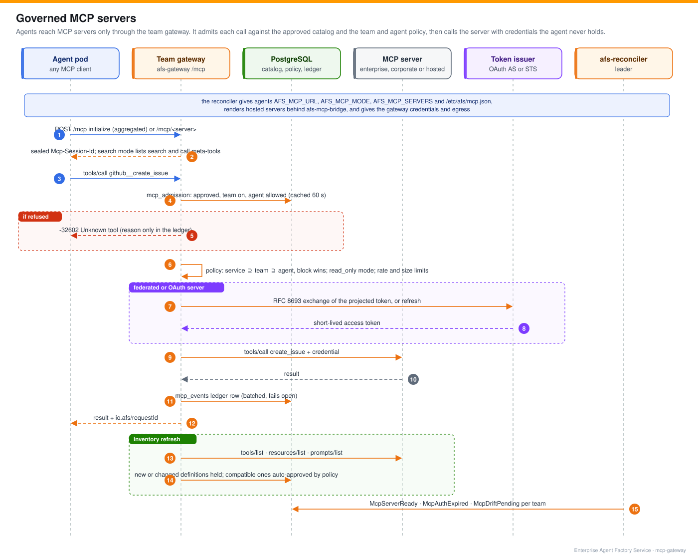

# Governed MCP servers

From 1.3.0, agents reach Model Context Protocol servers only through their team gateway. Service admins and security
operators keep a catalog of approved servers; team admins switch servers on for their team and narrow them per agent;
the gateway admits every call, holds the credentials and records a ledger row. Agents never hold an MCP credential.



## The catalog

- **Enterprise servers** are registered by a service admin (`CreateMcpServer`). **Team servers** are registered by a team
  admin when the team's gateway settings allow it (`mayAddMcpServers`).
- A server is `draft`, `pending_review`, `approved`, `rejected` or `suspended`. Approval follows the server's risk tier
  and the approval policy: team admin, service admin or security operator.
- The gateway refreshes each server's inventory (tools, resources, prompts). New and changed definitions are held for
  review; a compatible change (descriptions, optional inputs) is approved automatically only under the
  `auto_approve_compatible` drift policy.
- An external system whose host an approved server covers shows `governedBy` and cannot be switched on
  (`409 governed_by_mcp_server`); switch the server on instead.

## Locations and auth

| Location | Reached at |
|---|---|
| `external`, `corporate` | the server's https URL, through gateway egress to that host only |
| `hosted` | `afs-mcp-<slug>` in the team namespace on port 8080, a container image behind `afs-mcp-bridge` (stdio to Streamable HTTP); only the gateway may connect |

Auth kinds: `none`, `static` (header from Secrets Manager), `oauth_client`, `oauth_user` (connect once with
`StartMcpOAuthConnect`; the gateway refreshes), `workload_federation` (RFC 8693 exchange of the gateway's projected
token) and `aws_sigv4`.

## Team switches and agent access

`PutTeamMcpServer` turns a server on with a team mode (`full` or `read_only`). Agents and pools carry `mcp`:

```json
{"mcp": {"access": "selected", "serverIds": ["mcp_01J..."], "mode": "search", "blocks": [{"serverId": "mcp_01J...", "name": "delete_*"}]}}
```

`access: all` (the default) means every server the team has on. `mode` is `full` (every allowed tool is listed) or
`search` (three meta-tools, `afs_search`, `afs_describe` and `afs_call`, for large catalogs); unset takes `mcp.default_agent_mode`. Policy narrows from
service to team to agent and a block at any level wins. The read shows `effective` (server ids) and `env`.

## What the agent gets

| Variable or file | Value |
|---|---|
| `AFS_MCP_URL` | `$(AFS_GATEWAY_URL)/mcp`, the aggregated endpoint (tools named `<server>__<tool>`) |
| `AFS_MCP_MODE` | `full` or `search` |
| `AFS_MCP_SERVERS` | the server slugs, comma-separated |
| `AFS_MCP_<SLUG>_URL` | `$(AFS_GATEWAY_URL)/mcp/<slug>`, one server alone |
| `/etc/afs/mcp.json` | the same, plus an `mcpServers.afs` entry most MCP clients read directly |

A refused call answers JSON-RPC `-32602` (unknown tool, resource or prompt); the reason is in the ledger only.

## Health and reports

The reconciler reports `McpServerReady`, `McpAuthExpired` and `McpDriftPending` per team and server. Usage, refusals,
discovery, adoption and unused views are in `GetMcpUsageReport` and `GetTeamMcpUsageReport`.
